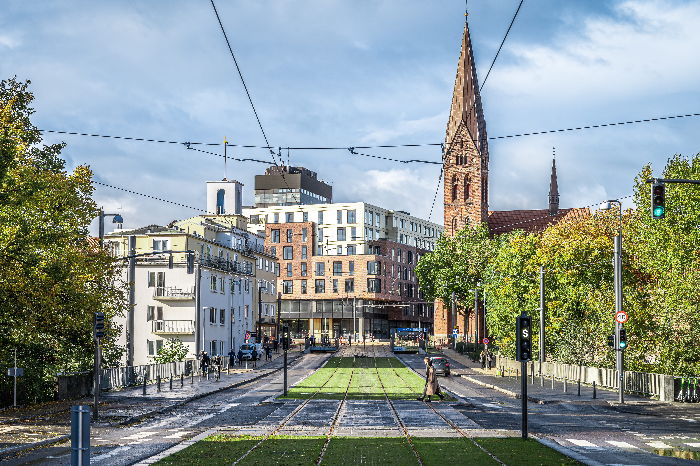

<figure>
  
  <figcaption>&copy; Destination Fyn, Erhvervshus Fyn</figcaption>
</figure>

The <b>24th International Conference on Quantum Physics and Logic (QPL 2027)</b> will be held from 5 to 9 July 2027 in Odense, Denmark. QPL is an annual conference that brings together researchers from academia and industry to explore a broad range of topics, from the fundamental foundations of physics to applications in quantum computing and communication, encompassing both near-term quantum technologies and future large-scale, fault-tolerant systems.

The conference particularly emphasizes the use of formal algebraic, logical, compositional, and categorical methods in the study of quantum theory and related fields. It also welcomes contributions that apply quantum-inspired concepts and techniques to other disciplines, including classical computation, linguistics, artificial intelligence, and causality.

### Important Dates

* Abstract submission deadline: Monday March, 1st 2027
* Paper submission deadline: Monday March, 8th 2027
* Notification: Monday April, 19th 2027
* Conference: Monday July, 5th to Friday, 9th 2027
<!-- * [Weekend workshops](/tutorial): -->
<!-- * [Career Fair](/career_fair): -->

All deadlines are stated with respect to the [Anywhere on Earth (AoE) time zone](https://www.timeanddate.com/time/zones/aoe).

For any inquiries regarding the conference organization, please contact us at [qpl2027@sdu.dk](mailto:qpl2027@sdu.dk). 

### Submissions

Prospective speakers are invited to submit one (or more) of the following:

* **Proceedings submission.** This consists of a 5-12 page paper. It must
  provide sufficient evidence of results of genuine interest, in sufficient
  detail for the program committee to assess the merits and correctness of the work.
  Proceedings submissions must use the [EPTCS style files](https://style.eptcs.org/).
* **Talk proposal.** This consists of a 3 page summary, together with
  a link to a separate published paper or preprint. If the published paper or
  preprint is not publicly available (e.g. not open access or online yet), then it should be
  included in full after the summary. Talk proposals not including a linked or attached published paper or preprint will be rejected outright.
* **Poster submission.** This consists of a 3 page summary of results, partial results or work in progress.

Proceedings submissions and talk proposals that are not accepted to the conference are automatically considered for a poster.

Page limits exclude bibliography, acknowledgements and appendices (which may be read at the
discretion of reviewers).
There will be an award for Best Student Paper that will be determined by the
Program Committee. Papers eligible for the award are those where all the
authors are students at the time of submission.

For inquiries related to the submission and review process, please write to the PC chair at [Robin Kaarsgaard](mailto:kaarsgaard@imada.sdu.dk) and mention QPL in the subject title. 

### Registration

Registration is not open yet. <!-- [open](/registration)-->

<!-- This year, QPL will be preceded by a weekend workshop consisting of tutorials on some of the main specialised topics of the conference. You can find more details [here](/tutorial). There is limited availability for these tutorials, preference will be given to registrations from junior attendees and early registrations.
Registration is now closed. Please see [here](/registration/) for further information regarding registrations.

### Presentations

Authors of accepted proceedings and non-proceedings submissions will be invited
to give a talk. Authors of accepted poster submissions will be invited to present
their work at the poster session.

[Conference program](/program/)

All talks will be 20 minutes long plus 5 minutes for questions.

#### Posters

Please see [here](/local_info/#poster-instructions) for guidance on preparing posters. -->

### Conference Proceedings

Conference proceedings will be published 
in [Electronic Proceedings in Theoretical Computer Science (EPTCS)](https://about.eptcs.org/) 
after the conference. When preparing the final version for publication, authors of
accepted proceedings submissions are allowed to use up to three extra pages
(i.e. up to 15 pages excluding bibliography) to address reviewer concerns and
suggestions under the proviso that they do not introduce new results.



### Sponsors

### Programme Committee Co-chairs

* [Robin Kaarsgaard](https://rkaarsgaard.github.io/) (University of Southern Denmark)



### Programme Committee
TBA

* Alastair Abbott, Inria Grenoble
* Matthew Amy, Simon Fraser University
* Pablo Arrighi, University of Paris-Saclay
* Miriam Backens, Inria
* Rui Soares Barbosa, INL – International Iberian Nanotechnology Laboratory
* Ämin Baumeler, Università della Svizzera italiana
* Alessandro Bisio, Università di pavia
* Robert Booth, University of Edinburgh
* Cyril Branciard, Institut Néel - CNRS
* Ulysse Chabaud, INRIA
* Giulio Chiribella, QICI Quantum Information and Computation Initiative, School of Computing and Data Science, The University of Hong Kong
* Nadish de Silva, Simon Fraser University
* Alejandro Díaz-Caro, Inria / LORIA & UNQ
* Cristhiano Duarte, Federal University of Juiz de Fora
* Ross Duncan, Quantinuum
* Pierre-Emmanuel Emeriau, Quandela
* Stefano Gogioso, University of Oxford
* Matty Hoban, University of Oxford
* Dominic Horsman, University of York
* Emmanuel Jeandel, Laboratoire Lorrain de Recherche en Informatique et ses Applications (LORIA)
* Anna Jenčová, Mathematical Institute, Slovak Academy of Sciences
* Robin Kaarsgaard, University of Southern Denmark
* Martti Karvonen, UCL
* Kohei Kishida, University of Illinois, Urbana-Champaign
* Aleks Kissinger, University of Oxford
* Hlér Kristjánsson, Université de Montréal & Mila
* Ravi Kunjwal, Université libre de Bruxelles
* Alfons Laarman, University of Leiden
* Martha Lewis, University of Amsterdam
* Konstantinos Meichanetzidis, Quantinuum
* Markus P. Mueller, Institute for Quantum Optics and Quantum Information (IQOQI) Vienna
* Nuriya Nurgalieva, ETH Zurich
* Anna Pearson, Quantinuum
* Simon Perdrix, LORIA
* Nicola Pinzani, NeverLocal
* Robert Rand, University of Chicago
* Neil Ross, Dalhousie University
* Mehrnoosh Sadrzadeh, University College London
* Nitica Sakharwade, Perimeter Institute of Theoretical Physics, & University of Waterloo, Canada
* Carlo Maria Scandolo, University of Calgary
* John Selby, ICTQT, University of Gdansk
* Peter Selinger, Dalhousie University
* Sonja Smets, University of Amsterdam
* Pawel Sobocinski, Tallinn University of Technology
* Priyaa Varshinee Srinivasan, Tallinn University of Technology
* Isar Stubbe, Université du Littoral
* Benoît Valiron, LMF - CentraleSupelec, Univ. Paris Saclay
* Augustin Vanrietvelde, Télécom Paris
* Renaud Vilmart, LMF
* Quanlong Wang, Quantinuum
* Julian Wechs, Université Libre de Bruxelles
* Mirjam Weilenmann, University of Geneva
* Alexander Wilce, Susquehanna University
* Lia Yeh, University of Cambridge
* Titouan Carette, École polytechnique
* Jacky de Beaudrap, University of Sussex
* Maris Ozols, University of Amsterdam and QuSoft
* Robert Spekkens, Perimeter Institute
* Juliana Vizzotto, Universidade Federal de Santa Maria


### Organising Committee

* [Robin Kaarsgaard](https://rkaarsgaard.github.io/) (University of Southern Denmark)
* [Zac Thomas Adams](mailto:zathad@sdu.dk) (University of Southern Denmark)
* [Mark Damon Walker](mailto:markwalker@imada.sdu.dk) (University of Southern Denmark)
* [Filippo Barbieri](https://www.linkedin.com/in/filippo-barbieri-02/) (University of Southern Denmark)
* [Vasilii Nikonov](mailto:vanik26@student.sdu.dk) (University of Southern Denmark)

### QPL Steering Committee

* [Bob Coecke](https://rel-int.ai/) (Relational Intelligence) 
* [Ana Belén Sainz](https://www.absainz.com/) (ICTQT, University of Gdansk)
* [Peter Selinger](https://www.mathstat.dal.ca/~selinger/) (Dalhousie University) 

### Previous QPL Editions

An archive of all previous QPL editions is [available](https://www.mathstat.dal.ca/~selinger/qpl/).
 
### Code of Conduct

Please make this conference a welcoming space for everyone. We ask you to use your real name when logging into any of our systems. Our conference is dedicated to providing a harassment-free conference experience for everyone, regardless of gender, gender identity and expression, age, sexual orientation, disability, physical appearance, body size, race, ethnicity, religion (or lack thereof), or scientific opinion. We do not tolerate harassment of community members in any form.

All communication should be appropriate for a professional audience including people of many different backgrounds. Sexual language and imagery is not appropriate for any venue this conference will be held in, whether physical or virtual. If you are being harassed, notice that someone else is being harassed, or have any other concerns, please contact a member of conference staff immediately. If a participant engages in harassing behaviour, the conference organisers may take any action they deem appropriate, including warning the offender or expulsion from the conference.

The dedicated safety and inclusion team will oversee reports of Code of Conduct violation. The team can be contacted at [qpl.safety.inclusion@gmail.com](mailto:qpl.safety.inclusion@gmail.com). The full team is to be announced later, but currently consists of:

* Ana Belén Sainz (ICTQT, University of Gdańsk)
* Robin Kaarsgaard (University of Southern Denmark)

Harassment may include but is not limited to:
* Offensive comments related to gender, gender identity and expression, sexual orientation, disability, physical appearance, body size, race, age, religion, or technology choices;
* Sexual language and images in slides or posters at the conference venue;
* Deliberate intimidation, stalking, or following;
* Harassing photography or recording;
* Sustained disruption of talks or other events;
* Inappropriate sexual attention;
* Advocating for, or encouraging, any of the above behaviour.
